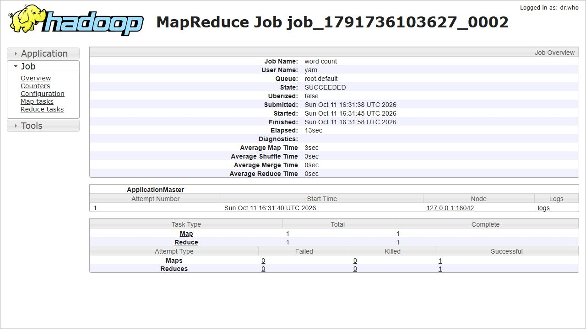
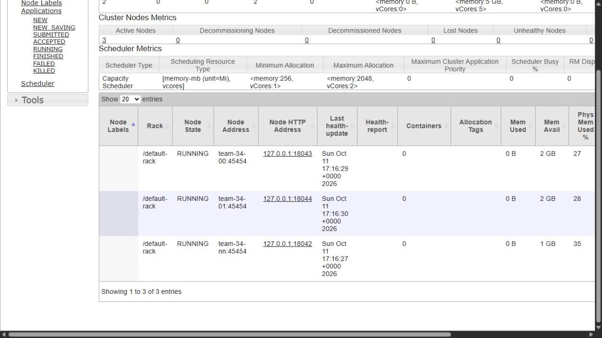
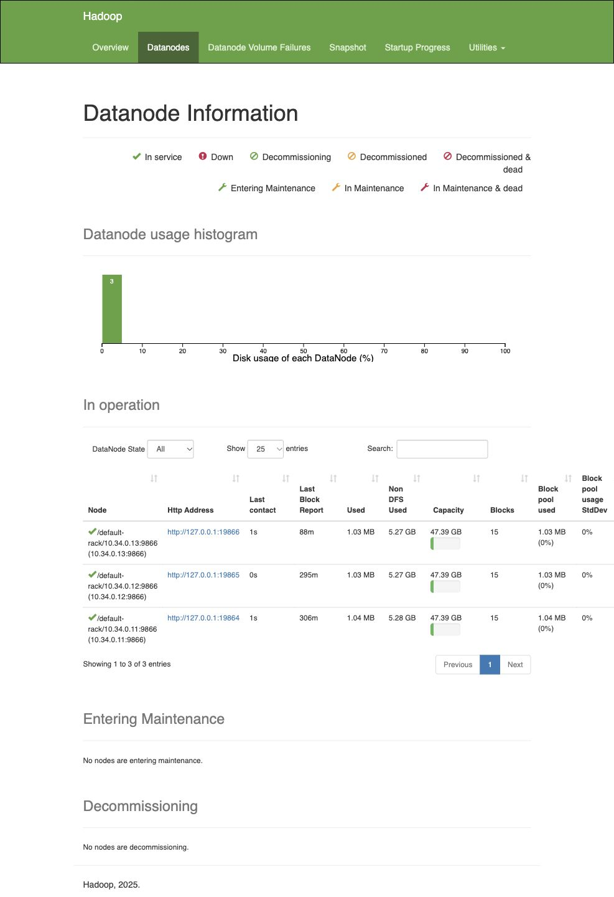

# ДЗ №2. YARN и веб-интерфейсы кластера

На HDFS из первого задания я развернул YARN: ResourceManager, три NodeManager и MapReduce JobHistory. Для веб-интерфейсов основных и вспомогательных служб настроил nginx на edge. Все десять интерфейсов опубликованы для внешнего использования через SSH-туннель к публичному адресу edge. Это основной проверенный способ доступа на выданном стенде. Дополнительные HTTPS-порты настроены, но прямой доступ к ним из внешней сети пока не подтверждён; подробности и команды находятся в [INSTALL.md](INSTALL.md).

## Размещение служб

Использовал тот же стенд team-34: Ubuntu 24.04, OpenJDK 11, Hadoop 3.4.2. nginx — версии 1.24.0.

| Машина | IP | Службы YARN и публикации |
|---|---|---|
| team-34-en | 10.34.0.10 | ResourceManager, JobHistory, nginx |
| team-34-nn | 10.34.0.11 | NodeManager |
| team-34-00 | 10.34.0.12 | NodeManager |
| team-34-01 | 10.34.0.13 | NodeManager |

HDFS продолжает работать в прежней конфигурации. На edge остаётся SecondaryNameNode, на `team-34-nn` — NameNode и DataNode, на двух остальных рабочих машинах — DataNode.

## Установка и настройки

YARN установил отдельными скриптами из `/home/team/hw2-yarn`:

```bash
bash scripts/deploy.sh
```

Скрипт использует Hadoop из первого задания, создаёт пользователя `yarn`, конфигурацию `/etc/hadoop-yarn` и службы `hadoop-resourcemanager`, `hadoop-nodemanager`, `hadoop-historyserver`. Все службы включены в автозапуск. Настройки HDFS в `/etc/hadoop` сохраняются, NameNode не форматируется.

В `yarn-site.xml` задал адрес ResourceManager, ресурсы NodeManager, shuffle-сервис для MapReduce и агрегирование логов в HDFS. В `mapred-site.xml` указал запуск MapReduce через YARN и адрес JobHistory. Для staging используется `/user/yarn/staging`, для логов — `/yarn-logs`, для истории — `/mr-history/tmp` и `/mr-history/done`.

На машине с NameNode выделил контейнерам 1024 MiB и 1 vcore, на двух других — по 2048 MiB и 2 vcore. Итого YARN располагает 5120 MiB и 5 vcore. Это оставляет память для HDFS и системных служб. Map, Reduce и ApplicationMaster используют по 512 MiB с heap 384 MiB. Проверка физической памяти включена; проверку виртуальной памяти отключил из-за резервирования адресного пространства JVM.

Web Application Proxy работает внутри ResourceManager по пути `/proxy/`. Отдельный Timeline Server в этой работе не разворачивал. Параметры стенда вынес в [cluster.env](cluster.env), подробную последовательность установки — в [INSTALL.md](INSTALL.md).

## Проверка YARN на WordCount

После установки дважды запустил пример WordCount через `scripts/verify.sh`. Входные данные:

```text
hadoop yarn hadoop
yarn cluster
```

Оба запуска выполнялись через YARN, получили идентификаторы приложений и завершились со статусами `FINISHED / SUCCEEDED`:

```text
application_1791736103627_0001
application_1791736103627_0002
```

Во втором запуске результат записан в `/user/yarn/hw2-check-20261011T163126Z-8104/output`. Содержимое выходного файла совпало с ожидаемым:

```text
cluster  1
hadoop   2
yarn     2
```

JobHistory сохранил сведения о задании: один map и один reduce завершились успешно, неуспешных и убитых попыток нет. Агрегирование логов завершилось со статусом `SUCCEEDED`; логи были получены командой `yarn logs`.



ResourceManager видит три NodeManager в состоянии RUNNING, lost и unhealthy узлов нет.



Вывод запуска сохранён в [verification.txt](evidence/verification.txt), результат подсчёта — в [wordcount-result.txt](evidence/wordcount-result.txt). Состояние приложений и история задания — в [yarn-applications.json](evidence/yarn-applications.json) и [job-history.json](evidence/job-history.json). Повторная проверка 11.10.2026 в 20:14 МСК также завершилась успешно: [review.txt](evidence/review.txt).

## Публикация веб-интерфейсов

На edge настроил reverse proxy nginx для десяти интерфейсов. Для прямого HTTPS использовал самоподписанный сертификат с внешним IP в SAN, TLS 1.2/1.3 и Basic Auth. Пароль и приватный ключ сертификата хранятся отдельно от файлов задания.

| Интерфейс | HTTPS-порт на 111.88.130.214 | Адрес через SSH-туннель |
|---|---|---|
| ResourceManager | 8443 | http://127.0.0.1:18088/cluster/nodes |
| NameNode | 8444 | http://127.0.0.1:19870/ |
| SecondaryNameNode | 8445 | http://127.0.0.1:19868/ |
| JobHistory | 8446 | http://127.0.0.1:19889/jobhistory |
| DataNode nn | 8451 | http://127.0.0.1:19864/ |
| DataNode 00 | 8452 | http://127.0.0.1:19865/ |
| DataNode 01 | 8453 | http://127.0.0.1:19866/ |
| NodeManager nn | 8461 | http://127.0.0.1:18042/ |
| NodeManager 00 | 8462 | http://127.0.0.1:18043/ |
| NodeManager 01 | 8463 | http://127.0.0.1:18044/ |

В nginx разрешил только GET/HEAD, чтобы через опубликованные интерфейсы нельзя было отправлять команды изменения состояния. Внутренние адреса в ссылках и перенаправлениях переписываются на соответствующие адреса прокси.

При проверке HTTPS со стороны edge все десять интерфейсов вернули 200 с авторизацией, 401 без пароля и 403 для PUT. Однако 12.10.2026 TCP-соединения с внешнего компьютера устанавливаются, а TLS-handshake завершается тайм-аутом. Открытый TCP-порт сам по себе не доказывает доступность HTTPS: [direct-public-check-20261012.json](evidence/direct-public-check-20261012.json). nginx слушает порты, UFW не активен; предполагаю, что соединения блокируются облачными сетевыми правилами. Открыть их в рамках работы не удалось, поэтому прямую публикацию HTTPS считаю незавершённой.

Для доступа с внешнего компьютера настроил второй набор nginx-портов, привязанных к loopback edge, и SSH-туннель через доступный порт 22. Через него открываются все десять интерфейсов. Переход ResourceManager → JobHistory и ссылки NameNode → все три DataNode проверены после исправления 12.10.2026. Результат проверки с внешнего компьютера — HTTP 200 на каждом адресе: [ssh-tunnel-check.txt](evidence/ssh-tunnel-check.txt). Скрипты туннеля для Windows и Linux/macOS находятся в [scripts/](scripts/); способ подключения описан в [INSTALL.md](INSTALL.md).

После установки и повторного развёртывания YARN HDFS остался целым: три DataNode работают, `fsck` показывает `HEALTHY`. Пароль nginx и сертификат при повторной установке сохранились.

[Условие задания на сайте курса](https://go.teachbase.ru/education/listener/course_player/sessions/1415858/tasks/412112).

## Проверка исправленной версии 12.10.2026

Полное повторное развёртывание завершилось `DEPLOY_OK`. Новый WordCount: `application_1791817038776_0001`, результат совпал с ожидаемым. `review.sh` завершился `REVIEW_OK`, HDFS — `HEALTHY`.

Ссылки на DataNode исправлены в публикуемом JavaScript NameNode. Файлы самой установки Hadoop не изменяются: nginx отдаёт отдельную версию `dfshealth.js` для SSH и HTTPS. При несовместимой версии интерфейса публикация останавливается с понятной ошибкой. Проверка `check-links.py` сопоставляет ссылки с живыми DataNode и открывает каждый интерфейс.

- [Повторное развёртывание](evidence/redeploy-20261012.txt).
- [Проверка служб и ссылок](evidence/review-20261012.txt).
- [Внешняя проверка через SSH](evidence/ssh-tunnel-check-20261012.json).
- [Ссылки, реально сформированные браузером](evidence/namenode-links-fixed.json).
- [Итоговый отчёт](evidence/REPORT-final.md).



Материалы ДЗ №1: [zarmeux/hw1-hdfs](https://github.com/zarmeux/hw1-hdfs). Этот репозиторий: [zarmeux/hw2-yarn](https://github.com/zarmeux/hw2-yarn).
